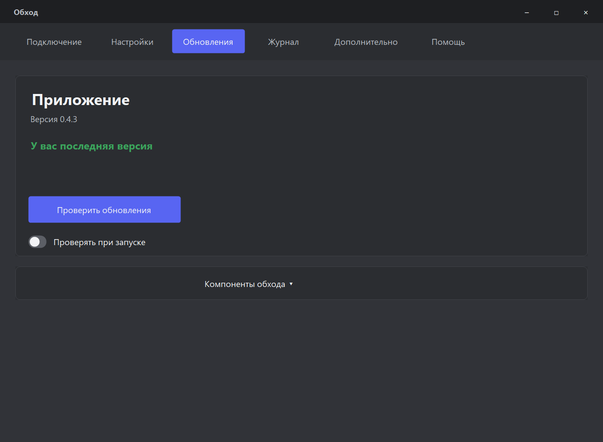

# Обход

Приложение для Windows 10/11 x64 с окном управления Flowseal zapret-discord-youtube. Это самостоятельная оболочка, не официальный продукт Flowseal. Версия оболочки **0.4.3**, включённое ядро **1.10.3**. Нужен .NET Framework 4.8.

**[Скачать последнюю версию](https://github.com/xxXdemidXxx/discord_obhod_app/releases/latest)** · [Инструкция для тестирования](TESTING-GUIDE.txt)

Окно изменяет размеры, поддерживает разворачивание и системный масштаб Windows. Тёмные списки и тонкие полосы прокрутки заменяют стандартные светлые элементы. Технические сведения вынесены в журнал и документацию.


## Запуск

1. Скачайте ZIP из Releases и распакуйте всю папку `Obhod` в постоянное место. Из архива приложение не запускайте.
2. Откройте `Obhod.exe`. В «Помощь» можно создать ярлык на рабочем столе.
3. Нажмите **«Подобрать автоматически»** или выберите стратегию и **«Применить и проверить»**. Запуск драйвера требует подтверждения UAC.
4. Результаты YouTube, Discord и GitHub видны рядом со стратегией. При смене стратегии приложение само остановит своё ядро, запустит новое и повторит проверки.
5. Крестик скрывает окно в трей. Для завершения выберите «Выход» у значка: остановится только собственный процесс ядра.

Ядро запускается без консольного окна. Всплывающих уведомлений оболочка не отправляет. Системный запрос UAC остаётся необходимым для WinDivert. Если работает другой winws или служба zapret, сначала остановите их в исходном приложении: оболочка не завершает чужие процессы.

## Автоподбор и диагностика

**Быстрый режим** включён по умолчанию: стратегии проверяются последовательно с тайм-аутом 6 секунд, первый вариант с 5/5 проверяется повторно с обычным тайм-аутом 12 секунд. При подтверждении подбор останавливается и оставляет обход включённым. При провале подтверждения поиск продолжается. **Полный режим** перебирает все стратегии с тайм-аутом 12 секунд, затем повторно проверяет варианты с 5/5 по возрастанию средней задержки. Если подходящего нет или нажата «Отмена», возвращается предыдущее состояние подключения. Кнопка «Остановить подбор» выключает обход. Двойной щелчок по строке истории выбирает стратегию для ручной проверки.

Пять проверок выполняются параллельно прямыми HTTPS-запросами без системного HTTP-прокси: сайт YouTube, изображение i.ytimg.com, сайт Discord, Discord API и страницу релизов GitHub. Тайм-аут — 12 секунд. При смене подключения старые результаты сбрасываются. Эти проверки не подтверждают воспроизведение видео, вход в аккаунт и голосовой UDP: проверьте ролик и голосовой канал отдельно.

Ошибка **DNS** означает, что Windows не определила имя. «Диагностика DNS» сравнивает Windows DNS с Google DNS через HTTPS и показывает текущие DNS-серверы. Системные настройки автоматически не меняются. У браузера может быть отдельный Secure DNS. [Инструкция Google для Windows](https://developers.google.com/speed/public-dns/docs/using#windows).

## Настройки и ядро

«Игровые соединения» (GameFilter) расширяют обработку на игровые порты. Для обычного использования оставьте выключенными. Режим находится в «Настройки», диапазоны скрыты под «Настроить порты»; менять их можно при выключенном обходе. Страница **«Дополнительно»** находится ближе к концу вкладок и задаёт правила обработки отдельных сайтов. Добавление домена не гарантирует доступ: zapret помогает против некоторых фильтров провайдера, но не меняет внешний IP и страну. Региональные ограничения самого сервиса и блокировки по IP этим не снимаются. YouTube и Discord уже настроены — добавлять их не требуется. Вставьте адрес или ссылку, нажмите «Добавить», затем «Сохранить». Удаление — крестиком рядом с адресом. «Редактировать списком» открывает полный редактор; там указываются домены без https:// и путей. Служебные строки ядра скрыты; пустой список безопасен для запуска. Поддерживаются IDN-домены, IPv4/IPv6 и CIDR. «Сохранить и применить» перезапускает собственный обход и проверяет сервисы. При работе другого winws сохранение заблокировано.
Стратегии читаются как данные; BAT не исполняются. Параметры передаются непосредственно winws. Для стратегий с `dpi-desync-fooling=ts` включаются TCP timestamps, как в исходном service.bat; это записывается в журнал. Остальные стратегии эту настройку не меняют.

Ядро обновляется отдельной кнопкой из [официальных релизов Flowseal](https://github.com/Flowseal/zapret-discord-youtube/releases/latest). Проверяются URL, размер и SHA-256 GitHub. Распаковка запрещает выход за каталог и символьные ссылки; проверяются файлы и стратегии. Пользовательские списки, GameFilter, изменённый IPSet и активные UDP-фейки сохраняются. Предыдущее ядро доступно для отката.

## Обновления приложения

Источник оболочки — **этот репозиторий**, стабильные GitHub Releases. Проверка при запуске включена по умолчанию; отключается в «Обновления». Автоматическая проверка выполняется **только при запуске**. Периодического опроса GitHub нет. Кнопкой «Проверить обновления» можно запустить проверку вручную.

Описание обновления (`update.json`) опубликовано в GitHub Releases рядом с ZIP. Приложение читает его через обычный адрес загрузки, без расхода лимита REST API. Если старый релиз ещё не содержит описания, используется один запрос к API. Обязательны точный URL этого репозитория, размер, SHA-256 архива и версия EXE. Проверки доступности GitHub также не используют REST API. Обновления официального ядра используют API; при ограничении повторный запрос откладывается до разрешённого времени, в окне показывается короткий статус.

Нажмите **«Проверить обновления»**. Если новая версия есть, та же кнопка станет **«Обновить»**. Проверка только получает описание релиза: скачивание и установка начинаются после нажатия «Обновить». Во вкладке видны прогресс, отмена загрузки и повторная попытка при ошибке — без отдельных окон. Приложение перезапустится и восстановит своё подключение, если оно было включено. При запуске без нажатия кнопки установка не начинается. Компоненты обхода вынесены в раскрываемый раздел.

Заменяются EXE и его config; `data`, настройки, списки и версии ядра не перезаписываются. Предыдущий EXE остаётся в `.previous`. Перед закрытием приложение проверяет готовность установщика. При ошибке замены восстанавливается прежний EXE, а результат показывается в той же вкладке после перезапуска.

Старые 0.1/0.2 не умеют обновлять оболочку: один раз установите 0.4.3 вручную; версия 0.3.0 умеет обновляться автоматически. Подпись издателя отсутствует; проверка SHA-256 удостоверяет соответствие опубликованному GitHub-архиву.



## Разработка и публикация

Без NuGet; сборка системным компилятором .NET Framework:

```powershell
./fetch-engine.ps1
./build.ps1
./test.ps1
./package-friends.ps1
```

`build.ps1` создаёт `dist/Obhod-0.4.3.exe`. `package-friends.ps1` создаёт чистый `releases/Obhod-0.4.3-win-x64.zip`, внутри стабильное имя `Obhod.exe`, стандартные настройки и проверенное официальное ядро. Личные списки и журналы не попадают в архив. `prepare.ps1` сохраняет локальные настройки и импортирует ядра для разработки.

Проверки охватывают разбор стратегий, Windows-кавычки, владение процессом, ZIP traversal, сохранение/откат, полный автоподбор, повторную проверку победителя, отмену, классификацию DNS/TLS и проверку метаданных релизов. Настоящий драйвер в тестах не запускается. С `./test.ps1 -Network` дополнительно проверяются реальные GitHub и HTTPS-запросы. Снимки окна сохраняются в `tests/window*.png`.

**Для новой версии:**

1. Увеличьте `AppVersion.Value` в `src/Version.cs`, например до `0.4.3.0`. Обновите `RELEASE-NOTES.md`.
2. Сделайте commit и push в `main`.
3. Workflow `Build, test and release` соберёт и проверит приложение, создаст тег `v0.4.3` и опубликует ZIP с SHA-256.
4. Установленные приложения получат новый релиз при следующей проверке. Повторный push с прежним номером не перезаписывает опубликованный релиз; для обновления нужен новый номер.

Pull request только собирается и проверяется, без публикации. GitHub Actions должен быть разрешён в настройках репозитория. Отдельные токены для сборки не нужны: используется ограниченный `GITHUB_TOKEN`.

## Исходники и лицензии

`src/Program.cs` — окно и трей; `Dashboard.cs` — стратегия и результаты; `StrategySelector.cs` — автоподбор; `Engine.cs`/`OwnedJob.cs` — запуск собственного ядра; `Checks.cs`/`DnsDiagnostics.cs` — диагностика; `Theme.cs`/`MainInterface.cs` — оформление и адаптивная раскладка; `DomainEditor.cs`/`DomainLists.cs` — списки сайтов; `Updates.cs` — обновления ядра; `ShellUpdates.cs` — обновления оболочки; `GitHubMetadata.cs` — ограничение повторных запросов; `NativeFrame.cs` — системная рамка.

Оболочка: MIT, [LICENSE](LICENSE). Компоненты ядра сохраняют исходные лицензии и уведомления: [Flowseal](https://github.com/Flowseal/zapret-discord-youtube), [zapret](https://github.com/bol-van/zapret), [WinDivert](https://github.com/basil00/WinDivert), [Cygwin](https://www.cygwin.com/), `licenses/Flowseal-LICENSE.txt` в каждой сборке.
