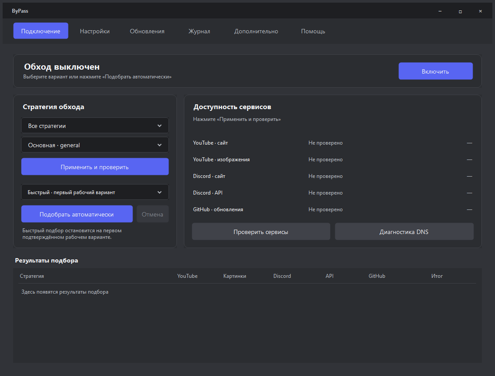

# ByPass

## [⬇ Скачать ByPass для Windows](https://github.com/xxXdemidXxx/discord_obhod_app/releases/latest/download/ByPass-win-x64.zip)

### Установка и первый запуск

1. Нажмите **«Скачать ByPass для Windows»** выше. Скачается файл `ByPass-win-x64.zip`.
2. Найдите его в папке **«Загрузки»**. Нажмите на файл правой кнопкой мыши → **«Извлечь всё»** → **«Извлечь»**.
3. Откройте распакованную папку **`ByPass`** и запустите **`ByPass.exe`**.
4. В окне программы нажмите **«Подобрать автоматически»**. Если Windows спросит разрешение на внесение изменений, нажмите **«Да»**.
5. Дождитесь завершения подбора. Откройте YouTube или Discord и проверьте, что они работают.

**Папку `ByPass` сохраняйте целиком.** Файл `ByPass.exe` и папка `data` должны лежать рядом. Программу можно перенести в удобное место, например `C:\ByPass`.

Подходит для **Windows 10/11, 64 бит**. Нужен **.NET Framework 4.8**. Git, команды и сборка программы для запуска не нужны.

### Как это работает

ByPass помогает восстановить доступ к YouTube и Discord через ваше обычное подключение к интернету. Программа использует Flowseal zapret и меняет способ передачи некоторых сетевых пакетов, чтобы обойти поддерживаемые фильтры провайдера.

Кнопка **«Подобрать автоматически»** пробует разные варианты и оставляет тот, который прошёл проверку. Результат зависит от провайдера и способа блокировки. IP-адрес и страна подключения не меняются.

### Что нажимать дальше

- **Выключить обход:** кнопка **«Выключить»** в программе.
- **Закрыть окно:** крестик справа сверху. Программа продолжит работать; её значок останется рядом с часами Windows.
- **Завершить программу:** нажмите правой кнопкой на значок рядом с часами → **«Выход»**. Если значка не видно, откройте стрелку **`^`** рядом с часами.
- **Обновить:** при появлении надписи **«Доступна новая версия оболочки»** или **«Доступна новая версия ядра»** нажмите рядом **«Обновить»**. В вопросе о подтверждении выберите **«Да»** или **«Нет»**. Без вашего согласия обновление не устанавливается.

### Если не заработало

Попробуйте выбрать **«Полный»** режим и снова нажать **«Подобрать автоматически»**. Если написано **«DNS»**, нажмите **«Диагностика DNS»**. Если запущена другая программа zapret, сначала выключите её.

Зелёные проверки показывают доступ к сайтам. **Видео YouTube и голосовой канал Discord проверьте сами.** Настройки игр и вкладку «Дополнительно» для обычного запуска менять не требуется.

### Проверка безопасности

Программа проверяет подпись обновлений и целостность ядра перед запуском. Если файлы изменены, запуск отменяется. Готовый выпуск проверяется Microsoft Defender; отчёт находится на странице версии. Сертификата проверенного издателя Windows пока нет, поэтому SmartScreen может показать предупреждение. Если антивирус пишет об угрозе, не отключайте защиту: сообщите название обнаружения через ссылку ниже. [Подробнее о защите](SECURITY.md).

[Подробная помощь](USAGE.md) · [Все версии](https://github.com/xxXdemidXxx/discord_obhod_app/releases) · [Сообщить о проблеме](https://github.com/xxXdemidXxx/discord_obhod_app/issues)

---

### Для разработчиков

Версия оболочки **0.5.0**, включённое ядро **1.10.3**. C# / WinForms, .NET Framework 4.8.

**[Сборка, тесты, устройство проекта и публикация → DEVELOPMENT.md](DEVELOPMENT.md)**

ByPass — самостоятельная оболочка для [Flowseal zapret-discord-youtube](https://github.com/Flowseal/zapret-discord-youtube), не официальный продукт Flowseal. Исходники оболочки открыты под [MIT](LICENSE). Лицензии компонентов [zapret](https://github.com/bol-van/zapret), [WinDivert](https://github.com/basil00/WinDivert) и [Cygwin](https://www.cygwin.com/) сохранены в сборке.
