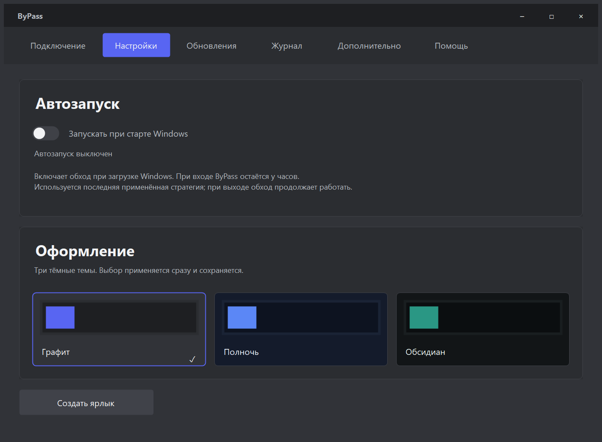
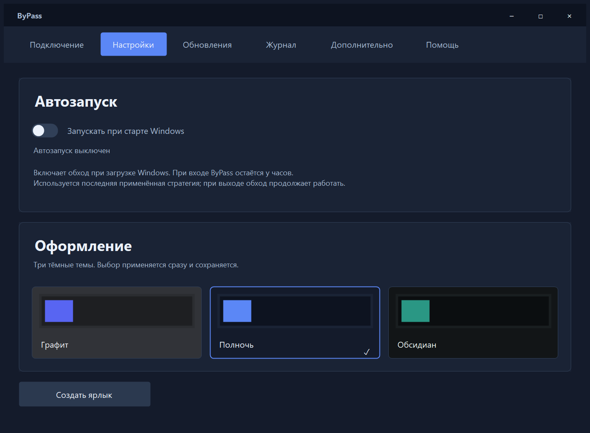
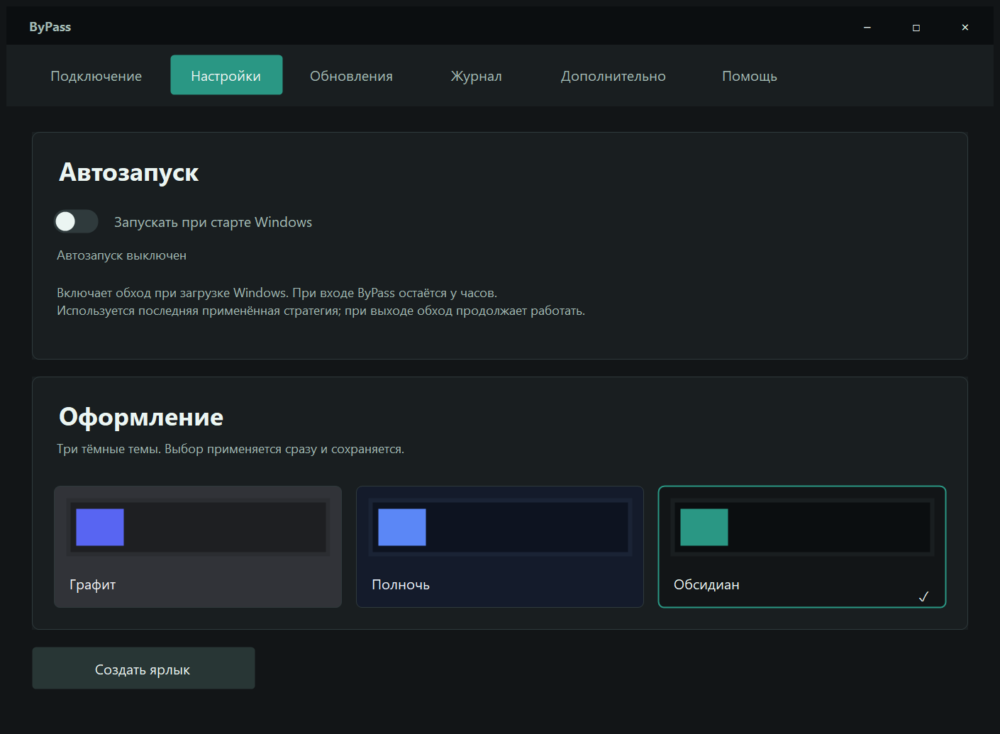
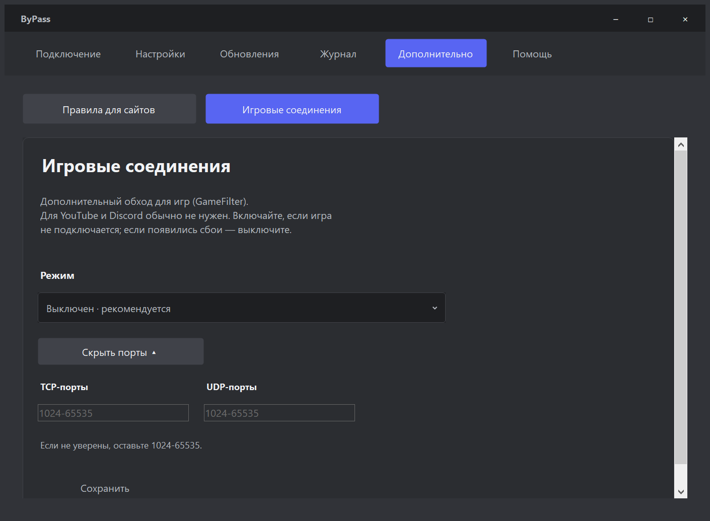
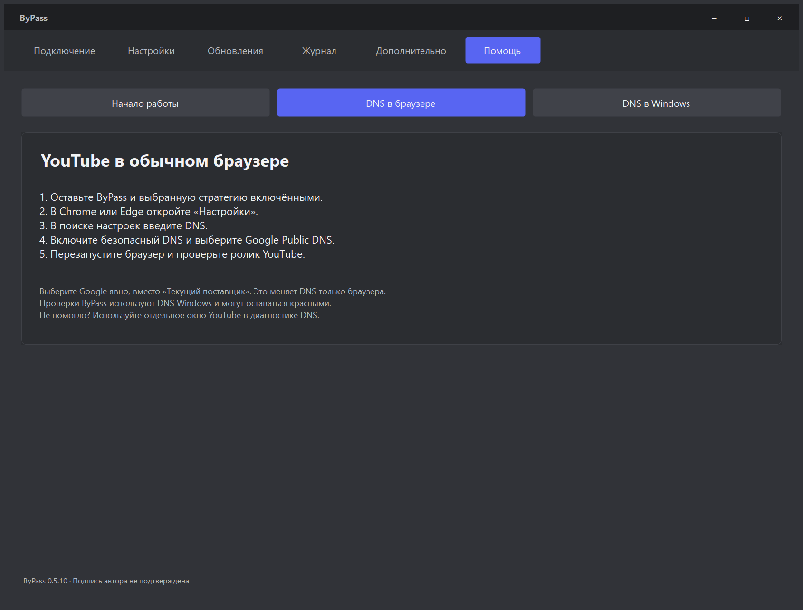
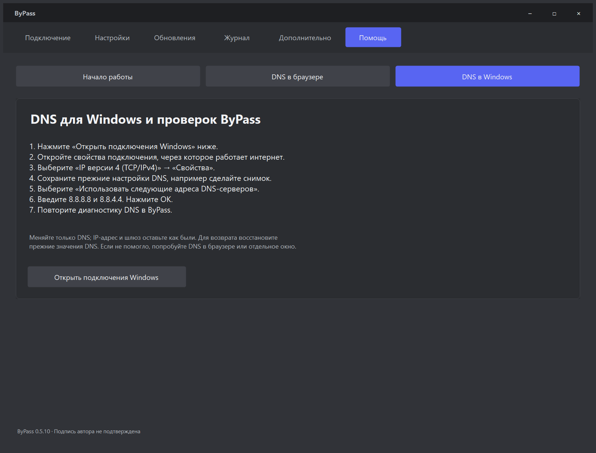
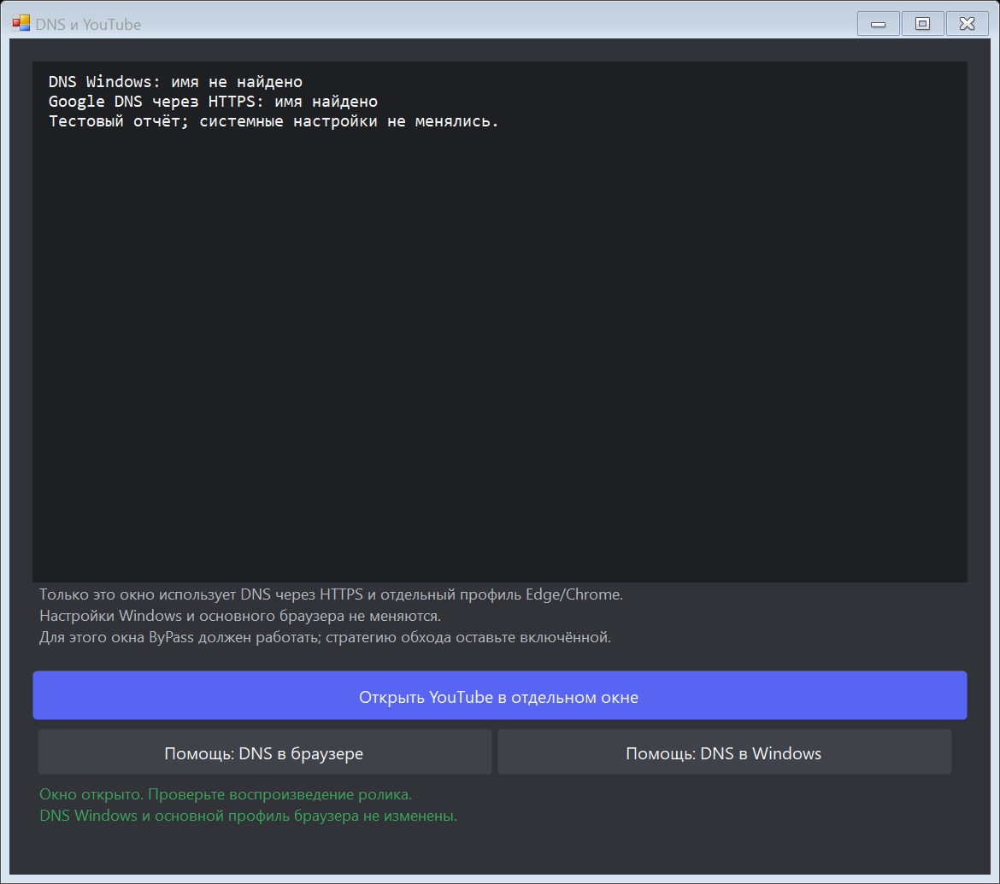

# ByPass 0.5.10 — понятнее настройки и помощь

В этой версии привёл повседневные настройки ByPass к единому виду. Автозапуск получил переключатель в стиле приложения и понятный статус. Исправил возврат переключателя в старое положение во время применения: теперь он ждёт ответа службы, а после отмены запроса Windows честно показывает прежнее состояние. Проверка службы и подготовка автозапуска выполняются в фоне.

Разгрузил настройки: игровые режимы и порты перенёс в «Дополнительно», рядом с правилами сайтов. Освободившееся место заняли три тёмные темы — Графит, Полночь и Обсидиан. Выбор применяется сразу и сохраняется.

Пересобрал «Помощь»: короткий старт и два пошаговых гайда DNS — для обычного браузера и для Windows. Из диагностики теперь можно сразу перейти к нужной инструкции.

## Изображения для публикации

Снимки получены из реальных WinForms-компонентов методом **DrawToBitmap** в автономных UI-тестах. Состояние службы, DNS-отчёт и данные сценариев тестовые; надпись о неподтверждённой подписи относится к тестовому EXE. Это не проверка подключения у провайдера. Метаданные и SHA-256: [manifest.json](../../assets/screenshots/v0.5.10/manifest.json).

Сравнение до обновления: [Настройки 0.5.9](../../assets/screenshots/v0.5.10/before-settings.png), [Помощь 0.5.9](../../assets/screenshots/v0.5.10/before-help.png).

## Проверки и границы

428 автономных проверок C#, 4 проверки переносимого ключа, 32 проверки выпуска и 20 проверок помощника владельца. Проверены ожидание ответа службы, отмена запроса Windows, сохранение и повторное применение темы, переходы из DNS и компактная раскладка. Настоящая установка службы, перезагрузка Windows и видео в сети брата в эти тесты не входят.

Источники инструкций: [Chrome](https://support.google.com/chrome/answer/10468685?co=GENIE.Platform%3DDesktop&hl=ru), [Edge](https://learn.microsoft.com/en-us/legal/microsoft-edge/privacy#secure-dns), [Google Public DNS для Windows](https://developers.google.com/speed/public-dns/docs/using#windows).